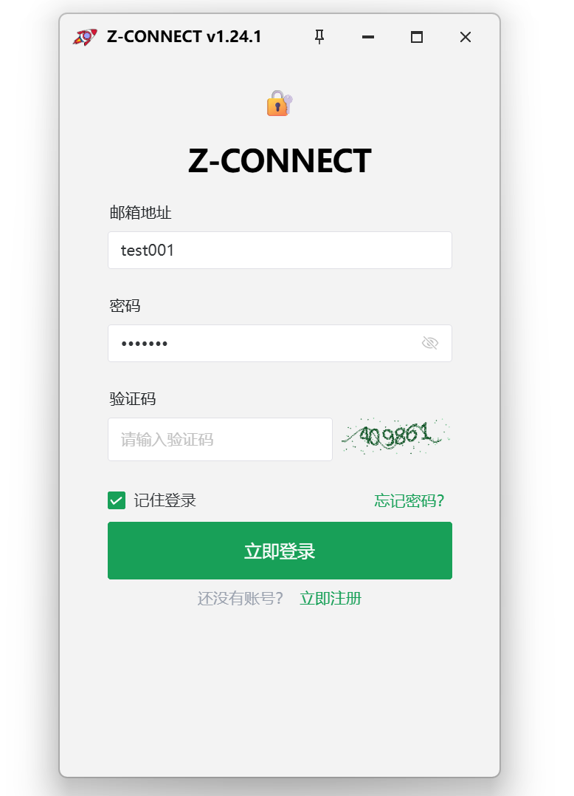
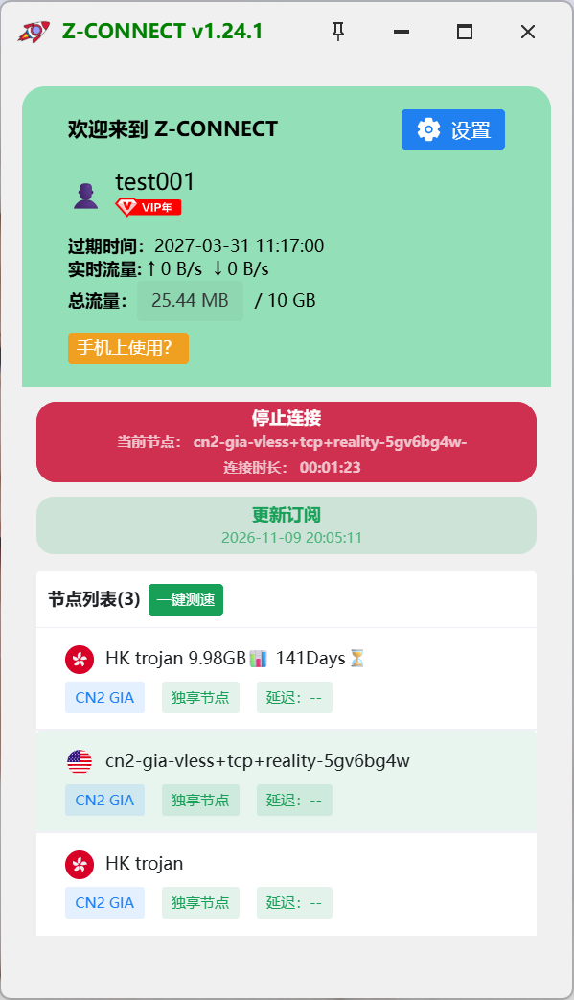

## Preview

    本项目仅供学习交流使用，无法直接依靠本项目实现代理效果！

<div align="center">
  
  
</div>

## Document

[Community](https://gui-for-cores.github.io/guide/gfs/community)

## Build

1、Build Environment

- Node.js [link](https://nodejs.org/en)

- pnpm ：`npm i -g pnpm`

- Go [link](https://go.dev/)

- Wails [link](https://wails.io/) ：`go install github.com/wailsapp/wails/v2/cmd/wails@latest`

2、Pull and Build

```bash
git clone https://github.com/GUI-for-Cores/GUI.for.SingBox.git

cd GUI.for.SingBox/frontend

pnpm install --frozen-lockfile && pnpm build

cd ..

wails build
```

## Stargazers over time

[](https://starchart.cc/GUI-for-Cores/GUI.for.SingBox)
